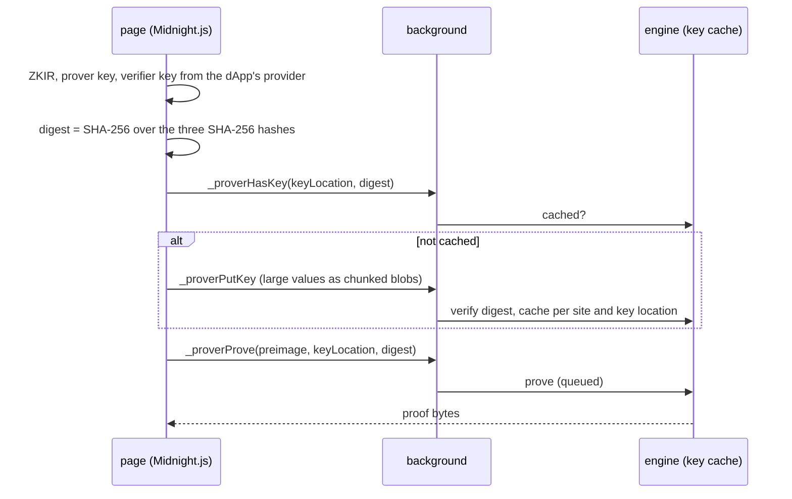

# dApp connector

How mdwa talks to dApps: the Midnight DApp Connector API 4.1.0
(`@midnightntwrk/dapp-connector-api`) on `window.midnight`. The engine side is
`extension/src/connector.js`, the routing and permissions are in
`extension/src/background.js`, and the page's object is `extension/src/inject.js`.
It was verified with Midnight.js 5.0.1: deploying and calling the counter
contract of the [local test dApp](#the-local-test-dapp). For the rest of the
wallet, see the [technical overview](technical.md).

- [Installing on the page](#installing-on-the-page)
- [Request path](#request-path)
- [Connecting](#connecting)
- [Beyond the standard API](#beyond-the-standard-api)
- [Permission model](#permission-model)
- [Methods](#methods)
- [Approval windows](#approval-windows)
- [getProvingProvider](#getprovingprovider)
- [On your own networks](#on-your-own-networks)
- [Errors](#errors)
- [Limits](#limits)
- [The local test dApp](#the-local-test-dapp)

## Installing on the page

`inject.js` runs in every `http` and `https` page at `document_start`, in the
page's own world. It creates `window.midnight` if no wallet has (a read-only,
non-configurable property), and adds the wallet under a fresh UUIDv4 key as a
read-only property nobody can overwrite. A wallet that came first keeps its
object and its entries. The `InitialAPI` object is frozen:

| Field | Value |
| --- | --- |
| `rdns` | `wallet.mdwa` |
| `name` | `mdwa` |
| `apiVersion` | `4.1.0` |
| `icon` | a data URL of the brand mark |
| `connect(networkId, options?)` | asks to connect, switching network if needed; returns the `ConnectedAPI` (see [Connecting](#connecting)). Without a network id, connects on the selected network; beyond the API (see [connect without a network id](#connect-without-a-network-id)) |
| `addNetwork(definition)` | offers a network to add; beyond the API (see [addNetwork](#addnetwork)) |
| `onNetworkChange(listener)` | calls `listener` when mdwa's network changes, while the page is connected; beyond the API (see [onNetworkChange](#onnetworkchange)) |

Only top-level frames get the object, since the content scripts are not
registered for iframes.

## Request path

```mermaid
sequenceDiagram
  participant P as page (inject.js)
  participant C as content script
  participant B as background
  participant E as engine worker
  participant W as approval window
  P->>C: postMessage { op, payload }
  C->>B: Port message (JSON; large bytes in chunks)
  Note over B: origin = what Chrome reports for the Port<br/>connection and permission checks
  B->>E: engine("connector", method)
  alt needs the user
    B->>W: open approve.html?id=n
    E-->>B: described, balanced transaction
    B-->>W: approvalUpdate (the effect)
    W->>B: approve or reject
    B->>E: complete (sign, prove, bind) or cancel
  end
  E-->>B: result
  B-->>C: result or error
  C-->>P: promise settles
```

- **Origin.** The site's origin is the one Chrome reports for the connection's
  Port, never anything the page says.
- **Wire.** Messages are JSON, and Chrome caps each one at 64 MiB. Amounts
  (`bigint` in the page) cross as decimal strings and are rebuilt as `bigint`.
  Bytes up to 256 KiB cross inline as base64. Larger values (a prover key can pass
  80 MB) are uploaded first in 8 MiB chunks, each waiting for the previous
  one's answer, and named in the request.
- **Keep-alive.** While a request waits (an approval window, a minutes-long
  proof), the content script pings the background every 20 seconds so Chrome does
  not stop the service worker and drop the request.
- **A locked wallet.** The three address methods are answered while the wallet is
  locked, since the addresses are stored with the wallet, except on a network
  the wallet has not opened on yet, whose addresses are made at the first
  unlock there. Anything else opens an unlock window, one at a time however
  many requests are waiting.

## Connecting

`connect(networkId, options?)` connects on the network the site names, and
switches mdwa to it when another network is selected. `options` is optional:
`{ endpoint?: string }`.

1. **Which networks.** mdwa takes its networks whose network id is
   `networkId` (for a network you defined, the network id in its definition).
   `endpoint`, when given, narrows them to the one whose node address, or for a
   network that takes transactions over HTTP its submit URL (the value
   `getConfiguration().substrateNodeUri` reports), is the same scheme, host,
   port and path, a trailing slash and any query aside. When none is left, the
   call fails with `InvalidRequest` and a message that begins
   `No network <networkId> in mdwa`, so a page can offer to add one.
2. **Already selected.** When the selected network is one of them, connect
   works as before: the first time a site connects on a network, a **connect**
   window asks, an approved site is stored per network and connects again
   without a window, and a network without a wallet fails with
   `InternalError`. The window says what the site will be able to do and that
   it can never move funds or sign without approval.
3. **Another network.** Otherwise mdwa switches and connects:
   - **silently** when the site is already approved on that network;
   - through the **connect** window when it is not. The window names the
     network the site asks for and says that connecting switches mdwa from the
     selected network to it. Rejecting leaves mdwa where it was and fails with
     `Rejected`.
   - When several networks match and `endpoint` does not single one out: the
     one the site is approved on, if exactly one; otherwise the window lists
     them (name and node address) and the user picks one.

A switch is the popup's own: the old network's session stops and saves its
snapshot, and the connections of every page on it end (below). It needs no
password. A locked wallet stays locked, and the first call that needs the
wallet opens the unlock window for the network switched to, which asks for
that network's password when it keeps a wallet of its own. A network without
a wallet fails as in step 2, before anything switches.

A switch is refused, with `InternalError` and a message saying that mdwa is
busy, while any other request's window is open (a transaction to approve, a
signature, an unlock) or the wallet is building, proving or sending a
transaction or showing one for review on the selected network. Connects that
switch run one at a time, so two pages asking at once cannot interleave: the
second sees the network the first left selected.

A wallet without switching (an older mdwa, or another wallet) fails a connect
for another network with `InvalidRequest` and a message containing
`is on <X>, not <Y>`; a page can then ask the user to switch by hand.

A connection is **bound to the network it was made on**. When you switch
network, remove the wallet or disconnect the site, every call of that connection
fails with `Disconnected`, and `getConnectionStatus` answers `disconnected`,
until the dApp connects again. Disconnecting a site in the Sites tab also
removes its stored permissions. A page that follows the network you select
connects without a network id and listens with `onNetworkChange` (see
[Beyond the standard API](#beyond-the-standard-api)).

## Beyond the standard API

mdwa adds three methods, one option and a connect without a network id to the
DApp Connector API 4.1.0. They are generic: nothing in them names a network or
a site. A page detects the methods with
`typeof wallet.addNetwork === 'function'`,
`typeof wallet.onNetworkChange === 'function'` and
`typeof api.watchToken === 'function'`; the option is `connect`'s
`{ endpoint }` (see [Connecting](#connecting)). Errors are the API's, as
everywhere (see [Errors](#errors)).

### connect without a network id

```ts
connect(networkId?: undefined | null, options?: object): Promise<ConnectedAPI>
```

- It connects on the network mdwa has selected at that moment, and never
  switches. It resolves to the same `ConnectedAPI` as `connect(networkId)`:
  `getConnectionStatus()` answers `connected` with that network's id, and
  `getConfiguration()` its endpoints.
- **Approval** is that of a connect naming the selected network (step 2 of
  [Connecting](#connecting)): the first time a site connects on a network, the
  **connect** window names the selected network and asks; an approved site
  connects again without a window. A locked wallet, a network without a
  wallet, a busy wallet and a rejection are handled as they are there, with
  the same codes.
- `options` may still be passed, and must be an object if it is; `endpoint`
  means nothing without a network id and is ignored.

### onNetworkChange

On the wallet object, beside `connect`:

```ts
onNetworkChange(listener: () => void): () => void
```

- It registers `listener` and returns a function that removes it. A listener
  that is not a function is `InvalidRequest`.
- **When.** `listener` is called with no arguments, once per change, when
  mdwa's selected network changes: you pick another network in the popup, you
  remove the selected network (mdwa selects Preview), or a site's `connect`
  for another network switches it.
- **Who.** Only a page that holds a connection on the network left, made by
  an origin still approved there, is told. A page that never connected, or
  whose origin is not approved, learns nothing, not even that a change
  happened. The notice carries no network id.
- **Then.** The page's connection ends as on any switch: every call fails with
  `Disconnected`. To follow mdwa, the page calls `connect()` again, which
  binds to the new network, silently if the site is approved there and
  otherwise through the **connect** window.
- The background sends the notice to the page's own document (Chrome's
  `documentId`), through the content script, which hands it to the page. Which
  pages hold a connection is kept in session storage, so a restart of the
  background's service worker does not forget it.

### addNetwork

On the wallet object, beside `connect`:

```ts
addNetwork(definition: {
  name: string;          // 1 to 32 characters
  networkId: string;     // as the chain's addresses carry it
  indexerHttp: string;   // the indexer's GraphQL HTTP URL
  indexerWs: string;     // its GraphQL WebSocket URL
  node?: string;         // a Midnight node's WebSocket RPC, or
  submitUrl?: string;    // an HTTP endpoint transactions are POSTed to
  dust?: boolean;        // whether the network has DUST; default true
}): Promise<{ status: 'added' | 'exists' }>
```

- Exactly one of `node` and `submitUrl`. Any other field, or a field of the
  wrong type, is `InvalidRequest`.
- **Already there.** A network with the same network id and the same
  addresses (indexer HTTP and WebSocket, and node or submit URL, compared as
  `endpoint` is above) resolves `{ status: 'exists' }` without a window.
- **Checked first.** Otherwise the definition gets exactly the checks a
  definition typed in **Add a network…** gets (see
  [Your own networks](technical.md#your-own-networks)): the network id's
  characters, each URL's scheme and the extension's page policy, and the
  chain's first block, read from the indexer and stored. A definition that
  fails is `InvalidRequest` with the reason, without a window: an indexer that
  does not answer, for example, is refused with
  `The indexer at <url> could not be read: …`. A name another network has gets
  the lowest number from 2 appended (`Local 2`) rather than failing.
- **The window** shows the site and the definition in the fields of the
  **Add a network** form, read-only, with the first block's hash. Approving
  adds the network and resolves `{ status: 'added' }`; rejecting is
  `Rejected`.
- Adding does not select the network: `connect` to it does.

### watchToken

On the `ConnectedAPI`:

```ts
watchToken(request: {
  kind: 'shielded' | 'unshielded';
  tokenType: string;        // the raw token type, 64 hex characters
  name: string;             // 1 to 32 characters
  symbol?: string;          // 1 to 8 characters
  decimals?: number;        // 0 to 18; default 0
  contract?: string;        // the minting contract's address, 64 hex characters
  domainSeparator?: string; // with contract: 64 hex characters, or the text of pad(32, "…")
}): Promise<{ status: 'added' | 'exists' }>
```

- It saves a label for the token on the connection's network, under the
  rules of labels typed in the wallet (see
  [Custom tokens](technical.md#custom-tokens)): lengths, reserved names, no
  control or invisible characters, no name or symbol another token has, NIGHT
  cannot be renamed. A request that breaks one is `InvalidRequest` with the
  reason.
- **Symbol.** Every label has a symbol. Left out, it is the name when the name
  is at most 8 characters; a longer name without a symbol is `InvalidRequest`.
- **Already saved.** The same name, symbol and decimals saved for that type
  and kind (and, when `contract` is given, saved with that contract and
  separator) resolve `{ status: 'exists' }` without a window.
- **Contract.** `contract` and `domainSeparator` come together. The wallet
  computes the token type they produce (the ledger's `rawTokenType`); a pair
  that does not produce `tokenType` is `InvalidRequest`. One that does is
  stored with the label, and the window says the contract mints the token.
- **The window** shows the site, the kind, the proposed name, symbol and
  decimals, the full token type, the contract when given, and the label it
  replaces when the token has another. Approving resolves
  `{ status: 'added' }`; rejecting is `Rejected`.
- No permission is asked beyond being connected; the window is the user's
  say. The label applies whether or not the wallet holds the token yet.

### The effect of a transaction

Every window for a transaction (**Approve transaction**, **Send from this
wallet**, **Create swap offer**) lists, under "Effect on this wallet", the
shielded coins the wallet receives or spends, with the unshielded ones, each
marked shielded. They are read from the balanced transaction itself:

- **Spent:** the shielded inputs whose nullifier is one of the wallet's coins
  (available or booked), as the SDK's state gives them.
- **Received:** the shielded outputs the wallet's keys decrypt. Each offer is
  applied to an empty local state with the ledger's own `ZswapLocalState`,
  which keeps exactly what decrypts to the wallet's keys, the test its sync
  applies; an output spent again in the same transaction (a transient) counts
  as spent too.
- The change of each token is the net of both. The details list the shielded
  inputs and outputs with how many are the wallet's.

The limit is the sync's: an output to the wallet's coin key that carries no
ciphertext for it is not seen, and the wallet's sync would not see it either.

## Permission model

| Tier | Methods |
| --- | --- |
| Free once connected | `getConfiguration`, `getConnectionStatus`, `hintUsage`, `getShieldedAddresses`, `getUnshieldedAddress`, `getDustAddress`, `getUnshieldedBalances`, `getProvingProvider`, `submitTransaction` |
| A window when something changes | `watchToken` (beyond the API) |
| A window every time | `balanceUnsealedTransaction`, `balanceSealedTransaction`, `makeTransfer`, `makeIntent`, `signData` |
| A stored grant per site and network | `getShieldedBalances`, `getDustBalance`, `getTxHistory` |

- **Free** means no window. The three address methods are free because Midnight.js
  needs the shielded keys up front and addresses are given out to be paid
  anyway. Unshielded balances are free because unshielded coins are public on
  chain. `getProvingProvider` is free because the preimages are the dApp's own
  data and are proved with your prover. `submitTransaction` only relays a
  transaction someone already signed and sealed.
- **Every time** means one window per call, and nothing is stored.
- **Behind a grant.** The API names these as data not to share lightly (DUST
  spends are private). The first call, or `hintUsage` naming them, opens a
  **permissions** window listing what is asked, in words. Approving stores the
  grant with the site and network; it shows in the Sites tab. Concurrent asks
  for the same methods share one window.
- **Sticky rejection.** A refusal is `PermissionRejected` for the life of the
  page's document, including after the dApp connects again, as the API requires.
  It is kept in session storage, so a restart of the background does not forget
  it, and dropped when the tab closes.

## Methods

Every method of `ConnectedAPI`:

| Method | Behavior |
| --- | --- |
| `getConfiguration()` | the indexer HTTP and WebSocket URLs, the node URL and the network id, as configured for the selected network, never with a Blockfrost project id. `proverServerUri` is added, as the API's deprecated field, only while you prove with a proof server. On Mainnet before you set its node and indexer, it fails with `InternalError` |
| `getConnectionStatus()` | `connected` with the network id, or `disconnected` |
| `hintUsage(methodNames)` | asks for the grants of the gated methods named, in one window; returns nothing. Unknown names are `InvalidRequest` |
| `getShieldedAddresses()` | the shielded address, coin public key and encryption public key, Bech32m |
| `getUnshieldedAddress()`, `getDustAddress()` | the address, Bech32m |
| `getUnshieldedBalances()` | a map of token type to amount |
| `getShieldedBalances()` | a map of token type to amount (gated) |
| `getDustBalance()` | `{ balance, cap }` in SPECK (gated). The cap counts only NIGHT the wallet still holds: DUST whose backing NIGHT is spent only decays |
| `getTxHistory(pageNumber, pageSize)` | `{ txHash, txStatus }` items, newest first (gated). Pages count from 0, a page is 1 to 1000 items. Status is `pending`, `confirmed`, `finalized` (with `executionStatus`) or `discarded` |
| `balanceUnsealedTransaction(tx, { payFees })` | balances a transaction the dApp built (hex), after a window shows its effect; returns `{ tx }`, sealed |
| `balanceSealedTransaction(tx, { payFees })` | the same for a sealed transaction |
| `makeTransfer(desiredOutputs, { payFees })` | builds a transfer to the given outputs (shielded or unshielded, by the recipient's address); returns `{ tx }`, sealed |
| `makeIntent(desiredInputs, desiredOutputs, { intentId, payFees })` | builds a swap offer; returns `{ tx }`, sealed |
| `signData(data, { encoding, keyType })` | signs a message after a window shows it |
| `submitTransaction(tx)` | submits a sealed transaction to the node, without a window |
| `getProvingProvider(keyMaterialProvider)` | a `ProvingProvider` whose proofs are made by the wallet; see below |

Details:

- **`payFees`** defaults to `true`. With `false`, the wallet balances shielded
  and unshielded tokens but does not pay the fee in DUST, and the window says
  "Not paid by this wallet".
- **Results are not submitted.** The three transaction methods sign, prove and
  bind, and return the sealed transaction. The dApp submits it, through
  `submitTransaction` or any other route. The wallet notes the transaction with
  the site, so the history names the site either way.
- **Swap offers in Activity.** An offer made by `makeIntent` shows in Activity as
  "Swap offer for" the site's host, with status Offered until a counterparty's
  transaction including it reaches the chain (it then reads as any other
  transaction) and Expired once its coins are released unused. Until then it holds
  the whole coins it spends, change included, so less is available to send.
- **`makeIntent`** puts an unshielded swap in segment 1. `intentId` of `1` or
  `"random"` is accepted and anything else is `InvalidRequest` (the SDK's
  `initSwap` takes no id, so the wallet refuses instead of ignoring it).
  `payFees` must be a boolean.
- **`signData`** takes `keyType: "unshielded"` only, and `encoding` of `hex`,
  `base64` or `text`. The bytes signed are `midnight_signed_message:<length>:`
  followed by the decoded data, so a signature here can never be a transaction
  signature. The ledger's Schnorr signs the SHA-256 of that message (BIP-340). The
  result is `{ scheme, data, signature, verifyingKey }`.
- **`getTxHistory` limits.** The SDK keeps one status per transaction, not per
  segment. A finalized transaction reports `{ 0: "Success" }` or
  `{ 0: "Failure" }` for segment 0 only (a partial success is reported as segment
  0 succeeding, without saying which later segment failed); a confirmed one has no
  result yet, so its `executionStatus` is empty. Entries whose hash is not a
  transaction hash are left out: the SDK records a finalized transaction that
  was never submitted (a swap offer handed to the dApp) under its serialized
  bytes.
- **Expiry.** A transaction the wallet balances for a dApp expires an hour
  after it is balanced (a transfer built by `makeTransfer`: 30 minutes). A preview that is not answered in 10 minutes is dropped
  and its coins given back.
- **Waiting for the wallet.** A request that arrives right after an unlock waits
  for the wallet to start, and for balancing methods to be synced, for up to
  three minutes, and then fails with a message saying so.

## Approval windows

Each request that needs you opens a separate 440 by 680 pixel window, with the
site's origin and the network. Closing the window rejects. The windows of a
connect that switches network, of `addNetwork` and of `watchToken` ask for no
password: they need nothing of the selected wallet's keys.

| Window | Shows |
| --- | --- |
| Unlock | a password field, when the wallet is locked |
| Connect | what the site will be able to do, on which network |
| Switch network and connect | the network the site asks for (or the matching networks to choose from), that connecting switches mdwa to it from the selected one, and what the site will be able to do |
| Add this network | a site's network definition in the **Add a network** form's fields, read-only, and its first block |
| Name this token | a site's label for a token: kind, name, symbol, decimals, the token type, and the contract when given |
| Allow these requests | each requested method in words, with its name |
| Approve transaction | contract calls and deploys, the effect on this wallet (shielded and unshielded token changes and the DUST fee), and a collapsed breakdown (inputs, outputs, how many of each are the wallet's, DUST spends); the site's raw transaction is behind Show |
| Send from this wallet | the outputs the site asked for, the effect and the fee |
| Create swap offer | what you give and what you ask for, the effect and the fee |
| Sign message | the message as text when printable, otherwise as hex, and its encoding |

A transaction's window opens at once and says it is preparing, while the wallet
balances (after an unlock in the same window, if needed). It then shows the
**balanced** transaction's real effect, computed from the transaction the wallet
will sign, not from what the site says, and Approve becomes available. Balancing
books the coins it spends. Approving makes the engine sign, prove and bind, and the
window shows the proving stage. Rejecting, or closing the window, reverts the
booking so the coins are free again. A request the wallet cannot build (not
enough funds, a busy wallet) shows why and can only be closed. A malformed
request closes without asking.

If the wallet cannot describe a transaction, the window says so and tells you to
approve only if you trust the site.

## getProvingProvider

Midnight.js proves contract circuits with a `ProvingProvider`. With mdwa,
`getProvingProvider(keyMaterialProvider)` returns one whose proofs are made by
the wallet, with the prover you picked for the network (the SDK's WASM prover,
or the proof server), through the engine's one-proof-at-a-time queue.



- **Key material** (the circuit's ZKIR and its prover and verifier keys) is read
  by the page from the dApp's own provider and uploaded to the wallet once per
  circuit. The wallet checks the SHA-256 digest the page computed, keeps the
  material per site and key location, and the page then asks whether the wallet
  already holds it, so the same key is not sent twice.
- **Cache.** In engine memory, shared by all sites, at most 384 MiB. The least
  recently used entries go first. A blob upload is at most 512 MiB, belongs to
  the site that sent it, is taken by the request that names it, and expires after
  five minutes.
- **Midnight's own circuits** (key locations starting with `midnight/`, such as
  the zswap and DUST circuits) use the SDK's key material, and nothing is
  uploaded for them.
- **Private data.** A preimage carries the user's private inputs. The wallet does
  not log or store it; it only hands it to the prover. With a proof server, the
  preimage and key material go to that server.
- **Checked before the queue.** With the WASM prover, every check and prove is
  first checked in the engine with the circuit runtime's own `check` (the
  function the SDK's proof worker runs). The SDK's proof worker answers a failed
  check or prove with nothing at all, so the caller would wait for the SDK's
  10-minute deadline while every other proof waits behind it. A preimage that
  does not satisfy its circuit is refused in milliseconds with the runtime's
  message and never enters the queue. A prove that fails after its check passed
  still waits for the deadline. With a proof server, the server answers a failed
  proof itself.
- **Free of a window.** A call is not asked about, but it is limited: only a
  connected page may upload, and while a proof runs the popup shows the wallet
  busy.

## On your own networks

On a network you defined (see [Your own networks](technical.md#your-own-networks))
the API is the same, with these differences:

- **`getConfiguration`** reports the definition's indexer URLs, and as
  `substrateNodeUri` its node or, for a network whose transactions go to an
  HTTP endpoint, its submit URL: the API requires a string there.
- **`submitTransaction`** submits as the definition says: to the node, or by
  POST to the submit URL.
- **Without DUST**, `makeTransfer`, `makeIntent` and both balancing methods never
  pay a fee, whatever `payFees` says, and the windows show no fee.
  `getDustBalance` answers a zero balance and cap, and `getDustAddress` still
  answers the DUST address the seed derives, so the API's shape does not change.

## Errors

Errors reach the page as `Error`s with `type: "DAppConnectorAPIError"` and a
`code` and `reason`:

| Code | When |
| --- | --- |
| `Rejected` | you declined a window (a connect, a switch, a network or a token name too), or the wallet is locked and you did not unlock it |
| `PermissionRejected` | a gated method without a grant, or one you refused (sticky for the page's life) |
| `Disconnected` | the connection ended: another network, a removed wallet, a disconnected site |
| `InvalidRequest` | a malformed request, an unknown method, `No network <networkId> in mdwa` on `connect`, a network definition or token label that fails its checks (with the reason) |
| `InsufficientFunds` | the wallet cannot cover the request, including too little DUST for the fee |
| `InternalError` | anything else, including no wallet on the network and a switch while mdwa is busy |

## Limits

- One transaction is balanced, proved or submitted at a time. A site's request
  that finds the wallet busy waits its turn, in order, for up to 15 minutes, and
  then fails with a message saying so; a request from the popup is refused at
  once.
- Proofs of the wallet and of dApps share one queue. A dApp's contract call
  waits behind a send, and the in-browser prover is slow; see
  [Proving](technical.md#proving).
- The connector object is installed in top-level frames only.
- `onNetworkChange` reaches a page that is loaded at the time of the change.
  A page in the back/forward cache then is not told; on its return its calls
  fail with `Disconnected`.
- Approval windows name a custom token by your label for it, or by its short
  type when it has none (see [Custom tokens](technical.md#custom-tokens)).

## The local test dApp

`dapp/` is a test dApp for the connector: a page with one button per connector
method, each showing its result or error, plus a contract round trip with
Midnight.js 5.0.1. The contract is `dapp/contract/counter.compact`, a public
counter with an `increment` circuit and a `deposit` circuit that also takes
NIGHT from the caller, both without witnesses, so a call proves quickly
and the round trip through the wallet (balance, prove, sign, submit) is what
gets exercised.

```bash
npm install --prefix dapp
```

```bash
npm run dapp
```

This builds the page with esbuild and serves it on `http://localhost:5190`,
bound to `127.0.0.1` (`node dapp/serve.mjs --port 5191` changes the port). The
compiled contract is served under `/managed`, the layout Midnight.js's
`FetchZkConfigProvider` reads. The page's network id field starts at
`undeployed`; change it to the network to connect on (mdwa switches to it), or
connect on the network mdwa is on without one.

```bash
npm run dapp:contract
```

compiles the counter with Compact 0.36.1 into `dapp/contract/managed` (about 200
kB; the output is kept in the repository). It expects the `compact` tool and the
public parameters in `~/.cache/midnight/zk-params`, or `MIDNIGHT_ZK_PARAMS`.

The page's actions: connect (with an optional endpoint, switching network),
connect on the wallet's network (no network id), connect to a network id mdwa
does not have, `addNetwork` and `watchToken` with a JSON
definition or token you edit on the page, the reads,
`signData`, the three transfers (unshielded, without fees, shielded),
`balanceSealedTransaction`, `submitTransaction`, `makeIntent` (and a refused
segment), deploy, increment, deposit and read counter, a transport test that
pushes a large prover key through the chunked upload, and a proof of a bad
preimage. The log shows a line when `onNetworkChange` fires. `npm run check:connector` drives this page through most of the
standard connector API.
