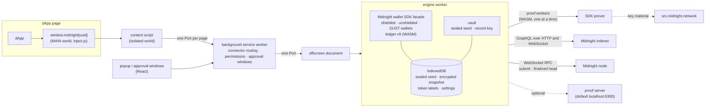
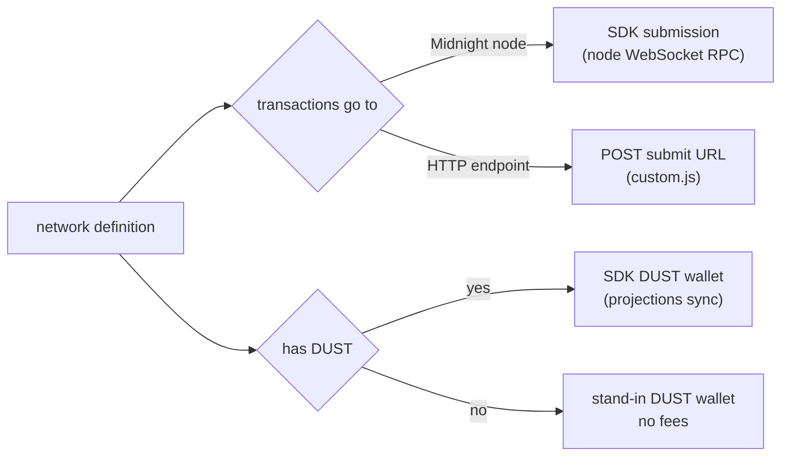
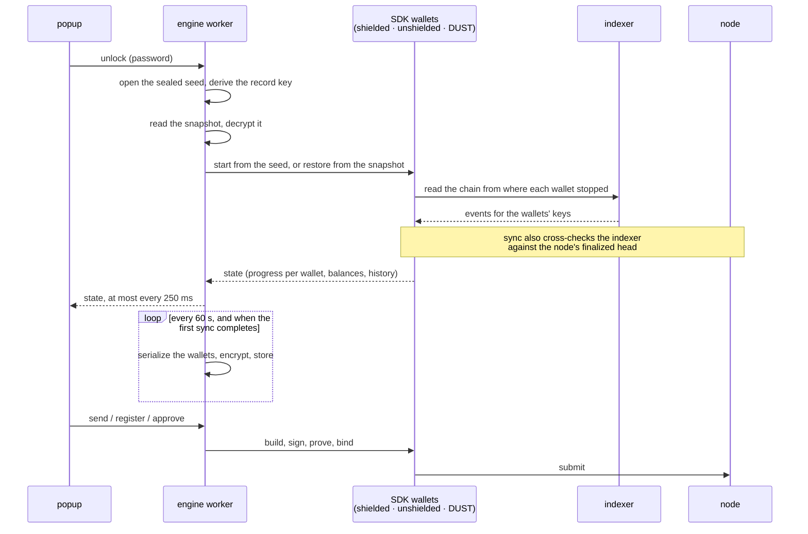
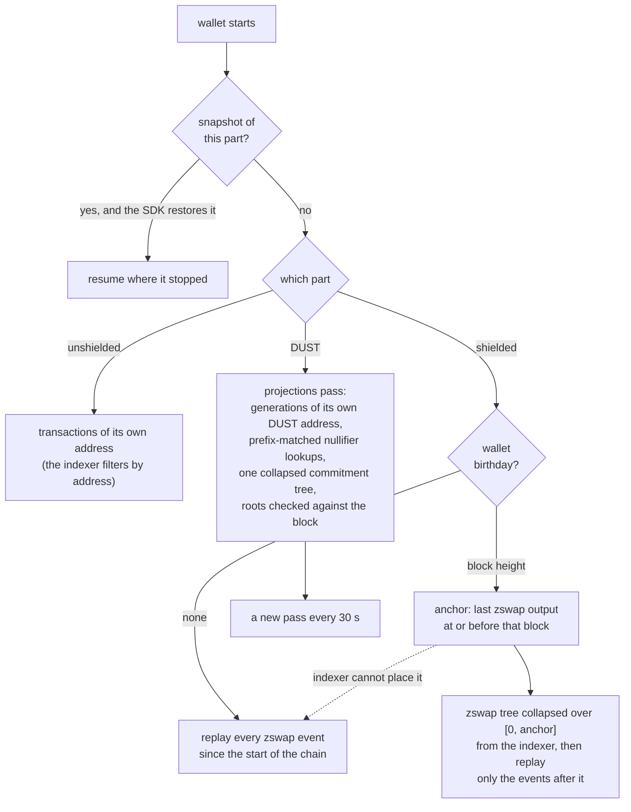
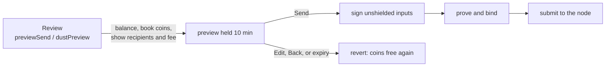

# Technical overview

How mdwa works, what it implements, how to build it, and its limits. For a
short introduction, see the [README](../README.md). The dApp connector has its
own page: [dApp connector](dapp-connector.md).

- [Architecture](#architecture)
- [Networks and endpoints](#networks-and-endpoints)
- [Your own networks](#your-own-networks)
- [How sync works](#how-sync-works)
- [Keys and unlocking](#keys-and-unlocking)
- [Proving](#proving)
- [Sending and DUST](#sending-and-dust)
- [Custom tokens](#custom-tokens)
- [The popup](#the-popup)
- [Building from source](#building-from-source)
- [Security model and limits](#security-model-and-limits)
- [Repository layout](#repository-layout)

## Architecture



The wallet is an MV3 extension, and a service worker cannot hold a long-lived
sync or run WASM workers. So the engine lives in an **offscreen document**
(created with the `WORKERS` reason) that hosts one dedicated worker. The
pieces:

- **Engine worker** (`engine-worker.js`, `midnight.js`, `connector.js`,
  `tokens.js`). It owns the SDK facade of the selected network, the vault and
  IndexedDB, and answers two method tables: `ui` (the popup) and `connector`
  (dApps, through the background). All Midnight logic runs here, from the
  SDK's packages. `midnight.js` has no storage and no messaging, so the same
  code also runs under Node in `scripts/smoke.mjs`.
- **Offscreen document** (`offscreen.js`). It relays the background's requests
  to the worker and broadcasts the engine's state to every extension page.
  Every request and answer between the background and the offscreen document
  travels one runtime Port, which the background opens, so a request (some are
  a dApp's key material, many megabytes) never reaches the other extension
  pages as a runtime message would.
- **Background service worker** (`background.js`). It routes requests to the
  engine, owns the per-site permissions in `chrome.storage.local`, runs the
  connector's permission checks and opens the approval windows. It never holds
  a seed. A password typed into a page passes through it to the engine and is
  not kept.
- **Popup and approval windows** (`extension/src/ui/`, React with Cloudflare's
  [Kumo](https://kumo-ui.com) design system and Tailwind v4). They show what the
  engine reports and send it requests. They load no WASM.
- **Content scripts** (`content.js`, `inject.js`). `inject.js` installs the
  connector object in the page's own world; `content.js` relays its calls to
  the background. Both are small classic scripts with no packages in them, and
  they run in every `http` and `https` page (top-level frames only, since the
  manifest does not ask for frames).

Chrome keeps an unpacked extension's background service worker across restarts
while the manifest version is unchanged. Every build therefore carries a build
id: pages compare it with the running background and reload the extension once
after a rebuild (`extension/src/ui/fresh.js`).

The extension's page policy allows `'wasm-unsafe-eval'` and connections to
`localhost`, `127.0.0.1`, the default endpoints' hosts, `srs.midnight.network`
and, because every endpoint is editable, any `https:` and `wss:` origin. Plain
`http:` and `ws:` reach `localhost` and `127.0.0.1` only, so a network you add
may not name another plain-HTTP host (see [Your own networks](#your-own-networks)).

## Networks and endpoints

| Network | Id | Default services |
| --- | --- | --- |
| Preview | `preview` | `rpc.preview.midnight.network`, `indexer.preview.midnight.network` |
| Preprod | `preprod` | Blockfrost (`midnight-preprod.blockfrost.io`), project id required |
| Mainnet | `mainnet` | Blockfrost (`midnight-mainnet.blockfrost.io`), project id required |
| Undeployed | `undeployed` | a local node at `ws://localhost:9944`, a local indexer at `http://localhost:8088` |

Preview is the default network. The table is in
[wallet/networks.mjs](../wallet/networks.mjs). Networks you define sit beside
these four; see [Your own networks](#your-own-networks).

- **Separate wallets.** Each network has its own recovery phrase, password,
  IndexedDB database (`mdwa-<network>`), snapshot, token labels and site
  approvals. Using one recovery phrase on two networks means restoring it on
  both. Only the selected network syncs; switching stops it, saves its
  snapshot and starts the other.
- **Editable endpoints.** Settings has the node RPC, the indexer's HTTP and
  WebSocket URLs, and, per network, the proving mode. The settings are stored
  once for all networks in `mdwa-settings`. Changing a network's indexer URL
  discards its snapshot, because a snapshot belongs to the indexer that
  produced it.
- **Blockfrost.** The project id is entered in Settings. It is appended as
  `?project_id=` to the node and both indexer URLs when the connection is
  made, never stored inside a URL, and never given to a dApp: what dApps see
  (`getConfiguration`) are the base URLs. Without an id on Preprod or
  Mainnet, the sync status says so and the wallet does not retry.
- **Units.** NIGHT has 6 decimals (smallest unit STAR) and DUST has 15
  (smallest unit SPECK). Other tokens have no decimals unless you label them.

## Your own networks

The network menu's **Add a network…** defines a network beside the four built-in
ones. Its form has:

| Field | Meaning |
| --- | --- |
| Name | shown in the network menu; 1 to 32 characters, unique |
| Network id | as the chain's addresses carry it (`undeployed` in `mn_addr_undeployed1…`): letters, digits 1 to 9 and hyphens, or `mainnet`, the SDK address codec's rule |
| Indexer HTTP, Indexer WebSocket | the indexer's GraphQL endpoints |
| Transactions go to | a **Midnight node** (its WebSocket RPC: the SDK submits, as on the built-in networks) or an **HTTP endpoint** (a submit URL, see [HTTP submission](#http-submission)) |
| This network has DUST | on by default; off for a chain without DUST, where nothing pays a fee |

Every URL is typed in full: nothing is derived from another. A URL the page
policy would block (plain `http:` or `ws:` to a host other than `localhost` or
`127.0.0.1`) is refused in the form with that reason; the policy is not
widened.

- **Storage.** A definition is stored in `mdwa-settings` under a key of its
  own (`user-` and 12 hex digits, also its database's name), not its network
  id, since two networks may share one (two local chains are both
  `undeployed`). Each network is its own wallet, as the built-in ones are.
- **Editing and removing.** **Edit network** (Settings, or the welcome screen of
  a network without a wallet) changes everything but the network id, which the
  wallet's addresses are made with. A network can be removed once its wallet is
  (Settings, Danger zone). Added networks show in a neutral color.
- **The chain's identity.** When a network is added, the wallet reads the hash
  of the chain's first block from its indexer
  (`block(offset: { height: 0 }) { hash }`) and stores it. Every start, and
  every edit, reads it again: another chain behind the same URLs is refused
  with a message saying so, and the wallet does not retry.



**Combinations.** The two switches are independent, and all four combinations
work: a Midnight node with DUST is a Midnight network like the built-in ones;
an HTTP endpoint without DUST suits a chain that has neither a node RPC nor
fees; a Midnight node without DUST suits a local chain whose fee price is zero;
an HTTP endpoint with DUST suits a Midnight chain reached through a relay. The
only requirement is the indexer's: it must serve what the chosen switches use
(below).

### A network without DUST

- **A stand-in DUST wallet.** The SDK's facade needs a DUST wallet and counts it
  in "synced"; the real one would wait forever for DUST queries such a network
  does not serve. The stand-in implements the SDK's DUST wallet interface: always
  synced, at the protocol version where the facade's ledger-9 epoch starts, no
  coins, a zero balance, zero fees, and the DUST address the seed derives (so
  `getDustAddress` answers as elsewhere). Start, stop, revert and snapshots do
  nothing; registering NIGHT or paying a fee in DUST is refused. It sends
  nothing to the indexer.
- **The start-up check** asks the indexer for `block`, `unshieldedTransactions`
  and `zswapLedgerEvents` only; the DUST queries and DUST passes do not apply.
- **No fees.** Every transfer and balance is built with `payFees: false`: the
  popup's sends, and a site's `makeTransfer`, `makeIntent` and both balancing
  methods, whatever the site asked.
- **The popup** shows no DUST card, DUST page, DUST address, DUST sync row,
  registration or fee line, and sync shows the shielded and unshielded wallets.

### HTTP submission

A network whose transactions go to an HTTP endpoint has no node URL: the SDK
skips its check of the indexer against a node's finalized head, and
`getConfiguration` reports the submit URL where the API asks for a node. The
wallet POSTs each finalized transaction's bytes to the submit URL with
`Content-Type: application/octet-stream` and reads the answer by what it proves
about the transaction's inputs. This is the contract such an endpoint follows:

| Answer | Means | The wallet |
| --- | --- | --- |
| 200, JSON `status` 0, `height` > 0 | applied in block `height` | resolves; sync sees it included |
| 200, `status` 1, `height` > 0 | its guaranteed segment applied in block `height` | resolves; sync shows each segment's result |
| 200, any other `status`, `height` > 0, `worker_rejected` false | failed in block `height`: nothing spent, nothing created | gives back the coins it booked at once, naming `status_name` |
| 200, `worker_rejected` true | refused before any block | gives back the coins |
| 400, 413, 415 | refused | gives back the coins |
| 503 with `error` `submission_disabled` or `busy`, or 429 | nothing taken | gives back the coins, with a clear message |
| 200 with `status_name` `panicked` or `outcome_unknown`, or no `height`; 502, 504, any other answer, no answer | it may or may not be in the chain | keeps the coins booked until sync sees it or it expires; the message gives `hash` when the answer has one |

The facade gives coins back only for an error that proves no block holds the
transaction's effects, so such an answer reaches it as the node client's
`TransactionInvalidError` (or `ConnectionError` when nothing was taken) inside a
`SubmissionError`. Inclusion is reported by the SDK's own polling of the
indexer, as on any network. The request times out after 75 seconds.

## How sync works



- **Three wallets.** The SDK facade runs a shielded, an unshielded and a DUST
  wallet from one seed (on a network without DUST, the DUST wallet is a
  stand-in, and the popup shows two). Each reads the chain its own way (below), reports its
  own progress, and the wallet counts as synced when the facade says so. The
  popup shows the three percentages separately and the mean in the header;
  while catching up, a figure never goes back. The indexer's latest block
  height is polled every 30 seconds for the "chain tip" line.
- **Resume.** The engine saves a snapshot every 60 seconds, as soon as the
  first sync completes, and when a session stops: the three wallets'
  serialized states, the transaction history and the transaction lifecycle
  records. It is encrypted (see [Keys and unlocking](#keys-and-unlocking)).
  After a browser restart the wallets restore from it and read only what is
  new. A snapshot whose history the SDK cannot read is ignored as a whole; a
  wallet part the SDK will not restore starts afresh on its own.
- **Rescan.** Settings, History has two. **Rescan** deletes the snapshot and
  syncs again, the shielded wallet from the wallet birthday. **Rescan from the
  start of the chain** (shown when the wallet has a birthday) also removes the
  birthday, for a wallet that received shielded tokens before it; it downloads
  the chain's whole shielded history. The wallet's notes about transactions it
  made itself are kept by both.
- **Failures.** If the connection fails, the engine retries after 2 seconds,
  doubling up to 60 seconds. The status shows the error in the meantime. An
  indexer that says (through GraphQL introspection) that it lacks a query the
  sync needs is named in the status, and the wallet does not retry.

### What each wallet downloads



- **Unshielded.** The indexer serves the transactions of the wallet's own
  address. Unchanged.
- **DUST: projections, not replay.** The SDK's default DUST wallet replays every
  DUST event of the chain, which was over 90% of a fresh wallet's download on
  Preview. mdwa builds the SDK's own forking DUST wallet with the projections
  sync the SDK ships (`SyncService.makeEventLessSyncService`): each pass asks
  for the DUST generations of the wallet's own DUST address, resolves which of
  its DUST was spent with nullifier lookups that match on a prefix only (so
  the indexer sees a group of nullifiers, not the wallet's), takes the DUST
  commitment tree as one collapsed update, and checks both tree roots against
  the block it read. A pass runs again every 30 seconds (the SDK's default is
  5, set through the configuration's `backgroundSyncInterval`), and every 3
  seconds while a fee this wallet paid waits for its block (see
  [Sending and DUST](#sending-and-dust)).
  A new wallet starts on the ledger version the chain's tip is on, since a
  projections wallet has no history to replay. This is the only DUST sync, on
  every network.
- **Shielded: from the wallet birthday.** The shielded wallet finds its coins by
  trying every zswap output of the chain with its keys, so it has to read the
  outputs since its first coin, but not before. A wallet record carries a
  **birthday**: a block height, or none for "from the start of the chain". At
  a fresh start the engine finds the anchor, the last zswap output at or before
  that block (its event id and Merkle index; event ids are the indexer's
  database ids, so the anchor is worked out again from the height against the
  indexer in use and never stored), fetches the zswap Merkle tree collapsed
  over everything up to it (`zswapMerkleTreeCollapsedUpdate`), builds the SDK's
  empty shielded state, applies that update, checks that the tree ends where
  the anchor says, and starts the SDK's shielded wallet there with its event
  cursor on the anchor, the same way the SDK restores a snapshot. From there it
  is an ordinary shielded wallet. **Shielded tokens received before the
  birthday are not found.**
- **Which birthday.** A new wallet is born at the chain's tip when it is created:
  its phrase was made just then, so nothing can have been sent to it before. A
  restored wallet has an optional **Wallet birthday** date. Left empty, it scans
  shielded tokens from the start of the chain. With a date, it scans from the
  last block at or before 00:00 UTC of that day, so it never starts later than
  any time zone's reading of the day; a date before the chain's first block
  means the start, a date after the tip means the tip, and a date in the future
  is refused. Wallets made before birthdays existed have none and keep the full
  history their snapshots already hold.
- **Fallbacks.** A chain with no zswap output by the birthday has nothing to
  skip, so the wallet starts at the beginning. If the indexer cannot place the
  birthday (no `zswapMerkleTreeCollapsedUpdate`, an inconsistent answer, an
  error), the shielded wallet syncs from the start of the chain and Chain sync
  says why; creating the wallet never fails for it. If the chain tip cannot be
  read when a new wallet is created, it is born at the start (correct, only
  slower) and says so. A restore with a date the indexer cannot place is
  refused, since the date was asked for.
- **Receive and Chain sync** say "Scanning shielded tokens from" the birthday
  block's date and height for a wallet with a birthday.

Measured on Preview on 18 November 2026 (block 166,650), one fresh wallet each,
counting every WebSocket frame and HTTP body the engine's Midnight code
exchanged until the facade reported synced (the same `midnight.js` under Node,
metered on the wire):

| Wallet | Before (event replay, no birthday) | New wallet (birthday at the tip) | Restore without a date |
| --- | --- | --- | --- |
| Wire bytes | 28.2 MB | 1.36 MB | 3.39 MB |
| Messages | 65,908 | 67 | 5,319 |
| Time to synced | 95.6 s | 7.1 s | 14.9 s |
| DUST events replayed | 60,558 messages, 24.8 MB | none (projections: about 3 KB) | none (projections: about 3 KB) |
| Zswap events | 5,269 messages, 2.0 MB | 3 messages | 5,271 messages, 2.0 MB |

In the extension itself, from the click on Create wallet or Restore wallet to
synced, on the same day: 8.5 seconds for a new wallet and 17.7 seconds for a
restore without a date (one run each). After a browser restart a synced wallet
resumes from its snapshot in about a second, unlock included.

About 1.33 MB of every figure is the node connection's start-up (the runtime
metadata the SDK's node client reads), which no sync mode changes. A wallet
that has spent DUST many times costs more on its first projections pass: each
of its past DUST spends is resolved by a nullifier lookup of its own, in
sequence, from block 0 (a test wallet with 344 spends took 345 lookups, 10 MB
and 27 s), and each later pass looks up every DUST coin the wallet holds.

### Wallets from before fast sync

A wallet made by an earlier version of mdwa has a DUST snapshot written by the
event replay. The SDK resumes it with the projections sync (it refuses only the
opposite, a projections snapshot handed to an event replay, through
`SyncService.resumableBy`), so on the first start after the update all three
parts resume from the snapshot: nothing starts afresh, and the first DUST pass
re-reads the address's generations from block 0 and checks the coins the
wallet already holds. If the SDK ever refuses a part of a snapshot, that part
alone starts afresh. Such a wallet has no birthday, and a rescan scans it from
the start of the chain as before.
- **Locked means not syncing.** The SDK needs the shielded and DUST secret
  keys to read the chain, so a locked network does not sync at all.
- **Spent coins.** A transaction the wallet builds books the coins it spends.
  Cancelling a review, or letting a preview expire (10 minutes), gives them
  back.

## Keys and unlocking

- **The seed.** A new wallet has 24 words from the SDK's mnemonic generator;
  a restore takes 12, 15, 18, 21 or 24 words, checked with the SDK's
  validator. The 64-byte BIP-39 seed (English word list, no passphrase)
  is the wallet. The SDK derives the unshielded, shielded and DUST keys from
  it. The three addresses are derived at creation and stored with the wallet,
  so they are shown while the wallet is locked.
- **Sealing.** The seed is encrypted with a key from your password: PBKDF2
  with SHA-256 (600,000 iterations) into AES-256-GCM, with a random salt and
  IV. The password is at least 8 characters. The recovery phrase itself is
  never stored; the wallet cannot show it again.
- **Records.** What the wallet knows about itself says which coins it owns:
  the SDK snapshot, the history, and its notes on its own transactions (kind,
  site, fee). These are encrypted with an AES-256-GCM key derived from the seed
  by HKDF, with the network in the derivation, so a record never decrypts on
  another network. Stored in the clear: the three addresses, the token labels
  (a name you typed or public contract data), the site approvals, and the
  settings including the Blockfrost project id.
- **Unlocking.** You enter the password once per browser session and network.
  The engine keeps the seed in memory until you lock the wallet, close the
  browser, or the engine stops. While it is unlocked, a send or an approval
  needs a click, not the password.

This differs from the Cardano sibling wallet, local-wallet, which asks for the
password on every signature. Here it cannot. A Midnight wallet cannot follow the chain with public
keys alone: the shielded and DUST wallets decrypt what they find with their
secret keys, so those keys, which come from the seed, must be in memory for as
long as the wallet syncs. So the password protects the seed at rest, and an unlocked wallet is
protected by the approval step: every spend from the popup is a review and a
click, and every dApp request is a window the page cannot click for you.

Removing a wallet (Settings, Danger zone) asks for the password, deletes the
network's database (sealed seed, snapshot, notes, token labels) and forgets
the network's site approvals. Funds stay on chain.

## Proving

A transaction with shielded or contract parts needs zero-knowledge proofs.
Proving is switchable per network in Settings:

- **In this browser (WASM).** The SDK's own prover (`WasmProver`) runs in
  workers of the engine. Nothing to install. Key material for Midnight's own
  circuits and the public parameters are fetched from
  `https://srs.midnight.network`, which the manifest lists as a host permission.
  It is slower than a proof server and memory-hungry: on the development
  machine a transfer's proofs took about 46 seconds, and an earlier
  measurement of a send with a shielded spend peaked at about 3.5 GB.
- **Proof server.** On the same machine, with the proof server on localhost,
  sends took 16 to 20 seconds from Send to submitted, and a contract deploy
  through the connector about 17 seconds.
- **Proof server setting.** A URL, `http://localhost:6300` by default (the
  `midnightntwrk/proof-server:9.0.2` image). The wallet sends proving requests
  to it.

By default the SDK starts one proof worker per proof, and the ledger asks for
all the proofs of a transaction at once. Each worker holds its circuit's keys and
parameters, so a transfer with a shielded spend ran eight workers and several GB
together, more than one browser renderer can hold; it crashed, and two at a time
still peaked at 4 GB. So the engine builds the SDK's proving service itself,
with the same key material and the same fork routing, and queues every `check`
and `prove` call so that **one proof runs at a time**. The queue is one for the
whole engine: the wallet's own proofs and the proofs a dApp asks for through
[`getProvingProvider`](dapp-connector.md#getprovingprovider) wait in it
together.

DApp circuits are proved by the same prover you picked for the network. With a
proof server, the dApp's key material is sent to it with each request, because
it holds only Midnight's own.

## Sending and DUST



- **Send.** Each recipient has an address, a token and an amount. The
  recipient's address decides the kind: a shielded address receives a shielded
  transfer, an unshielded address an unshielded one, and a DUST address is
  refused (DUST cannot be sent). Addresses are checked by the SDK's Bech32m
  codec and must be for the selected network. **MAX** gives a recipient what is
  left of that token after the other recipients. A transaction expires 30
  minutes after it is balanced; the review shows the time.
- **Fees.** The network fee is paid in DUST, not in the token you send. If the
  wallet has too little DUST, the send fails with a shortfall. A fee books the
  DUST coin it spends, and the DUST wallet learns the change coin only when a
  pass sees the transaction on chain. So while DUST is booked the engine asks
  for a pass every 3 seconds (for up to two minutes after the last new booking;
  a swap offer holds its coins longer and is left to the 30-second passes), and
  the change is spendable within seconds of the block. Until then the SDK's
  balance leaves the booked coin out (with one DUST coin it reads 0): Home and
  the DUST page show the last figure from before the fee, marked "updating",
  and `getDustBalance` answers the same figure.
- **One at a time.** One transaction is balanced, proved or submitted at a
  time. The popup's request is refused while another runs; a site's request
  waits its turn for up to 15 minutes (see
  [dApp connector](dapp-connector.md#limits)).
- **DUST.** NIGHT that you register for DUST generation produces DUST over
  time, up to a cap. The DUST page shows the balance, the cap, and registered
  against unregistered NIGHT. Register registers all unregistered NIGHT outputs;
  Stop generating deregisters all registered ones, and what was generated stays
  and decays slowly. A first registration pays its fee from the DUST its own
  NIGHT has generated; when that is not enough yet, the page says so and
  Register stays disabled until it is.
- **Activity.** History comes from the SDK. Each transaction shows its signed
  change per token, shielded tokens tagged, and DUST as the fee it paid. A
  transaction made by the wallet is labelled with what it was, and a dApp's with
  its site. Status is pending, confirmed, finalized or failed. A swap offer a
  site asked for shows as "Swap offer for" the site's host, Offered until it is
  taken and Expired once its coins are released; until then it holds the whole
  coins it spends.

## Custom tokens

Midnight has no token registry. A token's raw type is a one-way commitment of
a 32-byte domain separator and the minting contract's address, so a wallet
cannot read a token's name or contract off its type. Until you name it, a custom
token is shown as `Token` with its shortened type, and its quantity is raw.

- **Labels.** A label is a name (up to 32 characters), a symbol (up to 8) and
  decimals (0 to 18), per token type and kind (shielded or unshielded). Names
  and symbols that read as the network's own or as the wallet (`night`,
  `tnight`, `dust`, `tdust`, `midnight`, `mdwa`) are refused, so are control
  and invisible characters, and two tokens cannot share a name or symbol (a
  token's shielded and unshielded coins are the same token). NIGHT and DUST
  cannot be renamed. Labels are local to the browser, stored per network in the
  clear, and survive a rescan.
- **Watch token.** The Token page, and "Add a token" on Home, take a contract
  address (64 hex characters) and a domain separator (64 hex characters, or the
  text a contract writes as `pad(32, "…")`). The engine recomputes the token type
  with the ledger's `rawTokenType` and compares. With "Add a token" the label
  applies once coins of that type arrive. A label saved after a check keeps the
  contract address.
- **Names from contracts.** The engine reads the contract's public state from the
  indexer, and fills in a name, symbol and decimals only for four exact layouts of
  OpenZeppelin's native shielded token contracts (`NativeShieldedToken`,
  `NativeShieldedTokenCore`, `ZOwnableNativeShieldedToken` and
  `NativeShieldedTokenIssuer`, as compiled by Compact 0.36.1). Compact keeps
  no field names on chain, so a field can only be found by knowing the whole
  layout. A layout is used only when every top-level field matches, the token
  module says it is initialized, and the contract has `name`, `symbol` and
  `decimals` entry points or the stored domain separator is the one you supplied.
  Anything else gives no name.

What the check proves is **which contract mints the token type**. It does not
prove that the name the contract stores is honest: whoever deployed the contract
chose it, and the page says so.

## The popup

The popup is 380 by 600 pixels, with light and dark themes and a network color
for each network. It has:

- a network switcher showing which networks have a wallet, and **Add a
  network…** for your own;
- create and restore per network: 24 words for a new wallet, which starts at
  the current block, 12 to 24 for a restore with an optional wallet birthday
  date, and a password;
- **Home**: the NIGHT balance, DUST available, Receive, Send and DUST actions,
  a strip while the engine balances, proves or submits, a DUST card (balance
  against cap, registered and unregistered NIGHT), and the unshielded and
  shielded token lists with "Add a token";
- a sync pill in the header, and a **Chain sync** page with the three wallets'
  progress, the chain tip, and the node, indexer and prover in use;
- **Receive**: the unshielded, shielded or DUST address, as text and a QR code;
- **Send** and its **Review**, **DUST**, **Activity** (grouped by month, eight
  per page, with a detail page and the serialized transaction), **Token**,
  **Sites** (each approved site, its network, the permissions granted to it, and
  Disconnect) and **Settings** (connection, proving, lock, rescan from the
  birthday or from the start of the chain, remove wallet).

Approval windows (440 by 680 pixels) are separate browser windows opened by the
background; see [dApp connector](dapp-connector.md#approval-windows).

## Building from source

Prerequisites: Node and npm, and a Chromium-based browser (Chrome 116 or newer).
No other native tooling is needed.

```bash
npm ci
```

```bash
npm run build:extension
```

`npm run build:extension` writes the unpacked extension to `build/extension`.
Open `chrome://extensions`, enable Developer mode, choose **Load unpacked** and
select that folder.

### Try it in Helium

```bash
npm run helium
```

This builds the extension and opens [Helium](https://helium.computer) with its
own profile in `.helium-profile/` and the extension loaded. Your normal profile
is not touched. `--helium /path/to/binary` points it at another Chromium-based
browser (the default is `/Applications/Helium.app/Contents/MacOS/Helium`), and
`--profile 2` uses `.helium-profile-2/`, for a second wallet.

### How the build handles the WASM

The SDK ships its ledger and proving runtimes as wasm-bindgen "bundler"
packages, which import their `.wasm` file as an ES module. esbuild has no
loader for that, so `scripts/esbuild-plugins.mjs` emits each `.wasm` into
`build/extension/wasm/` and generates the module that instantiates it. The
module's own imports (the glue code) are read from the binary at build time and
bundled as ordinary modules, so each package exists once per bundle: a second
copy of a ledger would make its objects fail every `instanceof` check of the
first.

- **Workers** (the engine and the SDK's two proof workers) instantiate the WASM
  synchronously. Top-level `await` would let a worker's event loop run before its
  message listener exists, and the SDK posts a proof job right after creating a
  proof worker. The proof workers are emitted at `dist/` so the path the SDK
  computes from the engine resolves.
- **Pages** (background, offscreen, popup, approval) must not bundle a wasm
  package: the build fails if one does. The background cannot use top-level
  `await`, and the popup gets everything from the engine.
- **Checks.** The build fails if a bundle contains test-only SDK code, one of
  Node's test-only dependencies, or two copies of a ledger or ZKIR package.
- **The rest.** Tailwind v4 with Kumo builds one stylesheet; the manifest's
  page policy gets the default endpoints' hosts added.

The build uses esbuild with `chrome116` as the target. Node's `Buffer` and
`process` are shimmed for the SDK's address and codec packages.

### Checks

These scripts drive the engine and the connector under automation. Some need a
running local Midnight network and its funded seed; see each script's header for
its arguments.

| Command | Does |
| --- | --- |
| `npm run check:custom` | the code for your own networks under Node against an in-process stub indexer and submit endpoint, without network: definitions and their validation, the page policy check, the chain-identity check, the start-up check per DUST switch, the HTTP submission answers as the facade classifies them, the stand-in DUST wallet against the SDK's interface and "synced" |
| `npm run smoke` | the engine's Midnight logic under Node against a real network: a fresh phrase born at the tip, sync, addresses, balances, snapshot and resume of all three parts; with a funded seed (scanned from the start), sends and DUST registration |
| `npm run check:browser` | the built extension in a browser: the engine boots under the extension's policy, a wallet on Preview syncs, lock and unlock work, the WASM prover proves in a worker |
| `npm run check:connector` | the built extension and the test dApp in a browser, through every connector method, answering the approval windows (`--prover server` proves with the proof server, `--profile-root` picks where its throwaway profile goes) |

### The local test dApp

`npm run dapp` builds and serves the test dApp on `http://localhost:5190`
(`--port` changes it). Its packages are installed apart from the extension's, so
its ledger copy never meets the wallet's: run `npm install --prefix dapp` once.
`npm run dapp:contract` compiles the counter contract with Compact 0.36.1. The
compiled output is kept in the repository, so the dApp needs no compiler to run.
More in [dApp connector](dapp-connector.md#the-local-test-dapp).

## Security model and limits

- **Node and indexer are trusted for chain data.** The wallet reads the chain
  through the node and indexer you configure, and does not verify consensus
  itself. A malicious indexer could show invented history or balances, or hide
  real ones. It cannot spend your funds. The SDK cross-checks the indexer
  against the node's finalized head; that does not make either trustworthy. Use
  endpoints you trust. What the SDK itself sends to the indexer in order to sync
  is the SDK's and was not audited here.
- **The seed is in memory while unlocked.** See
  [Keys and unlocking](#keys-and-unlocking). The browser profile's disk holds the
  sealed seed and encrypted records; the addresses, token labels, site approvals
  and settings (including the Blockfrost project id) are not encrypted.
- **Password strength is yours.** The only rule is 8 characters. A weak password
  makes the sealed seed guessable offline.
- **Sites.** A site's origin is the one Chrome reports for its connection, not
  anything the page says. A site cannot move funds or sign without a window you
  answer. See [dApp connector](dapp-connector.md#permission-model).
- **Proving is slow and memory-hungry** in the browser; see [Proving](#proving).
  A proof server is faster but is software you run, and it sees the transactions
  you prove with it.
- **Token names are labels.** Yours, or a contract's, never a registry's.
- **The indexer supplies the starting trees.** A wallet that starts at its
  birthday takes the zswap Merkle tree up to the anchor from the indexer's
  collapsed update, and the DUST wallet takes its commitment and generation
  trees the same way. The wallet checks that the zswap tree ends at the
  anchor's index and that the DUST trees' roots match the block the indexer
  reports, but neither is cross-checked against the node. A wrong tree from the
  indexer cannot spend your funds; it would make the wallet miss coins or
  build transactions the chain rejects.
- **Shielded tokens before the birthday are not found.** A restore with a date
  skips everything before it; Rescan from the start of the chain finds it.
- **DUST sync and ledger forks.** The SDK's projections sync does not handle a
  protocol-version boundary (it reads no versions); every network is on ledger
  9 as of November 2026, so there is none to cross. A wallet with many past
  DUST spends pays for them on its first pass (see
  [What each wallet downloads](#what-each-wallet-downloads)).
- **Mainnet and Preprod sync were not exercised.** Development had no Blockfrost
  project id. Preview and a local network (Undeployed) were. Blockfrost's
  documentation lists the DUST queries the sync uses as Beta, and whether it
  offers `zswapMerkleTreeCollapsedUpdate` is unknown. If it says it lacks one of
  the sync's queries, Chain sync names it instead of syncing without end; a
  missing collapsed update makes the shielded wallet scan from the start of the
  chain. The Blockfrost endpoints in the table are defaults and may need
  editing.
- **One account per wallet.** One seed gives one set of three addresses; there is
  no account switcher and no address rotation.
- **Not implemented:** hardware wallets; sending DUST; signing data with
  anything but the unshielded key; other swap segments than 1 in `makeIntent`;
  a per-segment execution status in `getTxHistory` (the SDK keeps one status
  per transaction, so only segment 0 is reported).
- **Single-flight.** One transaction at a time, and one proof at a time.
- **Compatibility with other Midnight wallets' phrases** was not checked.
- **Browsers.** Built for Chrome 116 and newer; Helium is the other browser it
  was run in.

## Repository layout

| Path | Contents |
| --- | --- |
| `extension/manifest.json` | the MV3 manifest |
| `extension/src/background.js` | service worker: connector routing, permissions, approval windows, offscreen lifecycle |
| `extension/src/offscreen.js` | hosts and relays to the engine worker |
| `extension/src/engine-worker.js` | the engine: state, sessions, snapshots, the `ui` and `connector` tables |
| `extension/src/midnight.js` | everything that talks to the wallet SDK: facade (with the projections DUST sync and the birthday start), sync state, send, DUST, history, transaction descriptions, provers |
| `extension/src/custom.js` | your own networks: their definition and chain identity, the stand-in DUST wallet, HTTP submission |
| `extension/src/birthday.js` | the wallet birthday: dates to blocks, the shielded anchor and collapsed update, the indexer's query check |
| `extension/src/connector.js` | the connector's engine side: balancing, previews, signing, proving transport |
| `extension/src/tokens.js` | token labels and the watch-token check |
| `extension/src/vault.js` | seed sealing and the record key |
| `extension/src/db.js` | IndexedDB per network, and settings |
| `extension/src/inject.js`, `content.js` | the page's connector object and its relay |
| `extension/src/ui/` | popup and approval windows (React) |
| `wallet/networks.mjs` | built-in networks and user definitions, default endpoints and their checks, the page policy check, Blockfrost URL handling, units |
| `scripts/` | extension build and its esbuild plugins, Helium launcher, the smoke, browser, connector and custom-network checks |
| `dapp/` | the local test dApp: `index.html`, `app.js`, `serve.mjs`, `compile.mjs`, `contract/counter.compact` |
| `docs/` | this documentation and its screenshots |
